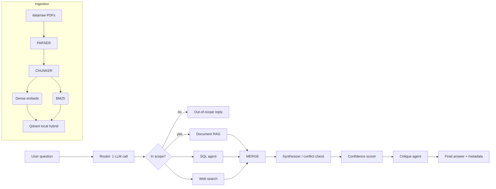

# InsightAI
[](https://github.com/SArora2712/InsightAI/actions)
---
**Business Analytics Copilot** — a multi-source AI assistant for Northwind
Traders that routes every question across **structured sales data (SQL)**,
**internal reports (Document RAG)**, and **live web context**, then explains
its confidence on each answer. Ships as a Streamlit app with a companion
FastAPI backend, and offers **two runtimes** — a deterministic workflow and an
autonomous agent loop.

---

## Highlights

- **Hybrid retrieval**: dense embeddings (BAAI/bge-small-en-v1.5) fused with
  BM25 sparse vectors in Qdrant (RRF), rescored by a cross-encoder reranker.
- **Defense-in-depth SQL**: a dedicated validator blocks anything but single
  `SELECT` statements; execution runs read-only with a built-in row limit.
- **Honest answers**: a rule-based confidence score (not LLM self-ratings) plus
  an independent LLM critique pass; conflicting sources are **surfaced, not
  silently merged**.
- **Two runtimes**:
  - `Workflow (v1)` — LangGraph: router → RAG/SQL/Web → synthesizer → confidence → critique.
  - `Agent (v2)` — ReAct loop with tool-calling, self-capped iterations.
- **Operational quality**: structured logging, per-query LLM call/token budgets,
  TTL caching, a performance-monitor page, and a pytest + GitHub Actions CI suite.

---

## Architecture



```
app.py                 Streamlit navigation controller (st.navigation)
chat2.py               Chat page — drives Workflow + Agent modes
pages2/                Dashboard · Executive report · History · Simulator · Performance
agents/orchestrator/   Router, LangGraph graph, synthesizer, confidence, critique
agents/sql_agent/      Schema linker → NL→SQL → validator → executor
agents/web_agent/      Search → web synthesizer
agents/agentic/        Tool-calling ReAct loop (v2)
ingestion/             Parser, chunker, embeddings, BM25, Qdrant store, RAG, reranker
core/                  LLM client, setup, history, theme, logging, env/secrets
api/main.py            FastAPI backend (/api/query, /api/simulate, /api/insights)
tests/ + eval/         Offline unit suite + integration tests
```

---

## Getting started

```bash
python -m venv .venv
.venv\Scripts\activate          # or: source .venv/bin/activate
pip install -r requirements.txt
cp .env.example .env            # create from template, fill LLM_API_KEY
streamlit run app.py
```

Secrets are read via `st.secrets` first, then the environment (`.env`).
Supported keys (see [Configuration](#configuration)).

FastAPI backend (optional):

```bash
uvicorn api.main:app --reload
```

---

## Configuration

| Variable | Default | Purpose |
|---|---|---|
| `LLM_API_KEY` | — | OpenAI-compatible key (Groq etc.) |
| `LLM_BASE_URL` | `https://api.groq.com/openai/v1` | Provider endpoint |
| `LLM_MODEL` | `llama-3.1-8b-instant` | Chat model |
| `TAVILY_API_KEY` | — | Web search |
| `QDRANT_URL` / `QDRANT_API_KEY` | local-only | Vector DB (empty → local embedded) |
| `QDRANT_LOCAL_PATH` | `./data/qdrant_local` | Local vector store |
| `CHUNK_SIZE` / `CHUNK_OVERLAP` | `120` / `20` | Document chunking (single source of truth) |
| `API_ACCESS_TOKEN` | *(empty = open)* | Bearer gate on FastAPI `/api/*` |
| `API_CORS_ORIGINS` | `localhost` | Allowed browser origins |

> ℹ️ **Index freshness**: adjusting `CHUNK_SIZE`/`CHUNK_OVERLAP` invalidates the
> cached index automatically (the cache key includes them), so the vector store
> rebuilds rather than serving a stale index.

---

## Tests

```bash
pytest                        # fast, offline unit suite
pytest -m integration         # needs the real index + optional LLM key
```

- **Unit** (`tests/`): router parsing, SQL validator, confidence scorer,
  tokenizer/chunker, env/secrets fallback, token tracker, API auth — no network,
  no model downloads, no key required.
- **Integration** (`eval/`): builds the real index and exercises the full graph,
  RAG retrieval, and the Agent v2 loop.

CI runs the unit suite on every push/PR (`pytest -m "not integration"`); the
integration job runs on manual dispatch. See `.github/workflows/ci.yml`.

---

## Benchmarks (representative)

| Scenario | Metric | Result |
|---|---|---|
| Total revenue by category (SQL) | latency (SQL exec) | ~ms |
| Internal-report question (RAG, hybrid) | retrieval time | ~instant |
| Multi-source conflict query | confidence scoring | deterministic |
| Out-of-scope question | agents invoked | `[]` → single reply |

> Exact numbers are environment-dependent (embedding model download, Qdrant
> local, LLM latency). Rerun `pytest -m integration` locally for yours.

---

## Security notes

- SQL is validated as a hard boundary before execution and runs **read-only**;
  only single `SELECT` (no chaining, no DDL/DML), with an implicit row limit.
- User-facing HTML is escaped before `unsafe_allow_html=True` everywhere.
- The FastAPI backend is open by default for local dev; set `API_ACCESS_TOKEN`
  and scope `API_CORS_ORIGINS` before exposing it.
- Secrets stay in `.env` (git-ignored) or Streamlit `st.secrets`; never commit.

---

## License

© InsightAI. For the Northwind Trade demo dataset (public domain sample).
